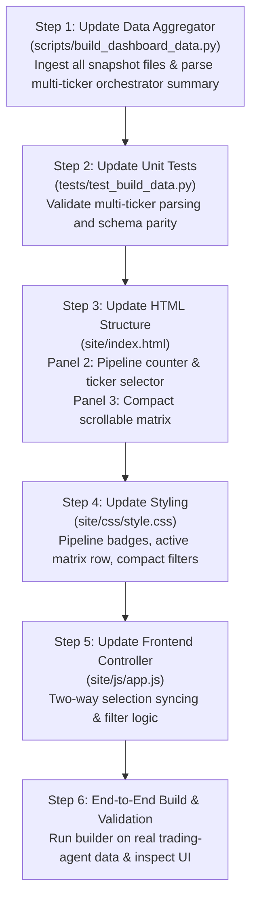

# Multi-Ticker Orchestrator Decision Funnel & Space-Efficient Market Matrix Plan

## 1. Executive Summary & Context

### 1.1 Context from the Mass News Sentiment & Chained Pipeline
The autonomous trading system ([`trading-agent`](file:///home/kalman/Desktop/git/trading-agent)) has transitioned from an external, single-repo architecture (`oil-signal` and `nvda-signal`) to an in-repo, chained multi-ticker pipeline driven by [`trading-targets/tickers.md`](file:///home/kalman/Desktop/git/trading-agent/trading-targets/tickers.md) and executed every 9 minutes:
1. **Stage 1 (`mass-news-sentiment.yml`)**: Concurrently collects benchmark prices and RSS feeds across 20–40 tickers, executes a strict 4-tier sentiment inference cascade (**Tier 1: GitHub Copilot** ➔ **Tier 2: Antigravity** ➔ **Tier 3: `GEMINI_API_KEY` Reserve** ➔ **Tier 4: Penalized Catalyst/FMP/eToro Fallback**), and persists rolling 24-hour state in `data/news_sentiment/<sym>-<id>-24h.json`.
2. **Stage 2 (`market-data-enrichment.yml`)**: Batches eToro quotes/candles and FMP 7-day corporate calendars, synthesizing `CompositeMarketSnapshot` files across all tickers in `data/market_snapshots/<sym>-<id>-latest.json`.
3. **Stage 3 (`trading-orchestrator.yml`)**: Evaluates all watched tickers concurrently through a 3-phase execution funnel (Phase 1: Pending Orders ➔ `cancel`, Phase 2: Running Positions ➔ `modify`/`close`, Phase 3: New Entries ➔ `open` ranked by 100-Point Confluence score), outputting [`reports/orchestrator/latest-cycle-report.md`](file:///home/kalman/Desktop/git/trading-agent/reports/orchestrator/latest-cycle-report.md).

Currently, `trading-agent` already generates multi-ticker telemetry for **22 active instruments** (`OIL`, `NVDA`, `MU`, `ORCL`, `CAT`, `GS`, `INTC`, `MS`, `PLTR`, `SHOP`, `AMD`, `ASML`, `ARM`, `TXN`, `COP`, `MRK`, `GOOGL`, `QCOM`, `AMZN`, `META`, `CRWD`, `HOOD`).

### 1.2 Objective & Strict Scope Boundary
The objective of this plan is to adjust **ONLY** two components of the **Trading Dashboard** ([`trading-dashboard`](file:///home/kalman/Desktop/git/trading-dashboard)):
1. **The Orchestrator Decision Funnel (Panel 2)**: Expand from displaying a single hardcoded instrument (`OIL`) to visualizing the full multi-ticker decision funnel (stage counts, candidate rankings, 100-point confluence breakdown for selected/top candidates, and sentiment inference tier/haircut alerts).
2. **The Market & Technical Section (Panel 3)**: Replace the single-instrument `Oil (ID 17)` card with a **space-efficient, high-density Multi-Ticker Market Matrix** that presents all relevant price, benchmark, sentiment, and technical data for all 20–40 tickers without cluttering the screen or demanding excessive vertical scroll.

> [!IMPORTANT]
> All other dashboard sections remain untouched:
> - Header & Top KPI Metric Strip
> - Active Positions & Human-in-the-Loop Controls (Panel 1)
> - Reconciled Equity Curve & Performance Scorecard (Panel 4)
> - Closed Trade Audit Journal (Panel 5)

---

## 2. Audit of Existing Dashboard Implementation vs. Target State

| Dashboard Component | Current Implementation | Target Multi-Ticker Implementation |
| :--- | :--- | :--- |
| **`scripts/build_dashboard_data.py`**<br>*(Market Payload)* | Reads only `data/market_snapshots/oil-17-latest.json`. Generates flat `market.json` dedicated to OIL. | Ingests all `data/market_snapshots/*-latest.json` files for all tickers in `trading-targets/tickers.md` (or discovers all files in directory). Emits structured `market.json` containing `tickers` (dictionary of all instruments), `summary`, and `selectedTicker`. |
| **`scripts/build_dashboard_data.py`**<br>*(Orchestrator Payload)* | Regex-parses only single-instrument confluence fields from `reports/orchestrator/latest-cycle-report.md`. Defaults to `OIL`. | Parses the `## 📊 Active Trading Suggestions Summary` markdown table across all 20–40 tickers plus individual instrument evaluation blocks. Emits `orchestrator.json` with funnel pipeline stages (`evaluated`, `parityPassed`, `thresholdPassed`, `vetoFree`), ranked candidate list, and detailed pillar breakdowns per ticker. |
| **Panel 2 UI**<br>*(Orchestrator Decision Funnel)* | Single confluence gauge (0–100) and 5 static pillar progress bars locked to `OIL`. Single diagnostic string. | **Funnel Visualizer**: Top horizontal funnel pipeline counter (`22 Watched ➔ 22 Parity Pass ➔ 6 Threshold Met ➔ 0 Actionable Entries`). Interactive candidate selector / mini-leaderboard showing top Phase 3 candidates. Detailed 5-pillar breakdown and active hard vetoes for the selected ticker. Inference Tier badge (Copilot / Antigravity / Gemini / Fallback Haircut). |
| **Panel 3 UI**<br>*(Market & Technical Section)* | Rigid single-instrument card displaying `OIL` quote, WTI/Brent divergence gauge, 7 technical cells, and oil sentiment. Cannot scale past 1 ticker. | **Space-Saving High-Density Market Matrix**: A compact, 350px-high scrollable matrix table displaying all 20–40 tickers with sticky headers, quick filter pills (`All`, `Stocks`, `Commodities`, `Bullish`, `Bearish`, `Actionable`), and synchronized row-click selection that updates the Orchestrator Funnel. |
| **Cross-Panel Interactivity** | None (both panels statically render `OIL`). | **Synchronized Ticker Selection**: Clicking any ticker row in the Market Matrix instantly focuses the Orchestrator Decision Funnel on that ticker's confluence breakdown, diagnostics, and parity status. |

---

## 3. Data Contract & Schema Specifications

### 3.1 Updated `site/data/orchestrator.json` Schema
`build_dashboard_data.py` will generate `orchestrator.json` supporting both the global cycle funnel and per-ticker evaluations:

```json
{
  "cycleTimestamp": "2026-11-08T06:10:58Z",
  "orchestratorEnabled": true,
  "cadence": "9m",
  "executionMode": "auto_execute_all",
  "dispatchChannel": "inline_prepare",
  "watchlist": ["OIL", "NVDA", "MU", "ORCL", "CAT", "GS", "INTC", "MS", "PLTR", "SHOP", "AMD", "ASML", "ARM", "TXN", "COP", "MRK", "GOOGL", "QCOM", "AMZN", "META", "CRWD", "HOOD"],
  "funnelMetrics": {
    "totalWatched": 22,
    "parityPassed": 22,
    "confluenceEligible": 6,
    "actionableEntries": 0,
    "activeProtectiveActions": 0
  },
  "topCandidate": "QCOM",
  "rankedCandidates": [
    {
      "symbol": "QCOM",
      "instrumentId": 1485,
      "confluenceScore": 89.0,
      "confluenceThreshold": 75.0,
      "action": "open",
      "direction": "buy",
      "convictionScore": 0.54,
      "assessmentProvider": "copilot_llm",
      "isFallbackSentiment": false,
      "hasHardVetoes": true,
      "hardVetoes": ["Market is closed for the weekend (isWeekendClosed=true)."],
      "status": "NO_ACTION"
    },
    {
      "symbol": "META",
      "instrumentId": 1003,
      "confluenceScore": 81.0,
      "confluenceThreshold": 75.0,
      "action": "open",
      "direction": "buy",
      "convictionScore": 0.3343,
      "assessmentProvider": "copilot_llm",
      "isFallbackSentiment": false,
      "hasHardVetoes": true,
      "hardVetoes": ["Market is closed for the weekend (isWeekendClosed=true)."],
      "status": "NO_ACTION"
    }
  ],
  "evaluations": {
    "QCOM": {
      "symbol": "QCOM",
      "instrumentId": 1485,
      "snapshotId": "snap_qcom_1485_20261108T061044Z",
      "confluenceScore": 89.0,
      "confluenceThreshold": 75.0,
      "status": "NO_ACTION",
      "confluenceBreakdown": {
        "regimeAndNews": { "score": 24.0, "max": 35.0 },
        "windowAndHtf": { "score": 15.0, "max": 20.0 },
        "momentum": { "score": 10.0, "max": 15.0 },
        "volatilityRvol": { "score": 20.0, "max": 15.0 },
        "spreadEfficiency": { "score": 20.0, "max": 15.0 }
      },
      "suggestion": {
        "action": "open",
        "direction": "buy",
        "convictionScore": 0.54,
        "suggestedLeverage": 5,
        "suggestedAmountUsd": 200.0,
        "suggestedStopLossRate": 160.2,
        "suggestedTakeProfitRate": 178.5,
        "assessmentProvider": "copilot_llm",
        "isFallbackSentiment": false
      },
      "diagnostic": "New QCOM entry blocked by hard veto(es): ['Market is closed for the weekend (isWeekendClosed=true).']",
      "parityChecks": { "allPassed": true }
    }
  }
}
```

### 3.2 Updated `site/data/market.json` Schema
`build_dashboard_data.py` will generate `market.json` aggregating all tickers with space-efficient summaries:

```json
{
  "capturedAt": "2026-11-08T06:10:44Z",
  "totalTickers": 22,
  "defaultSelectedTicker": "QCOM",
  "marketStatus": {
    "isWeekendClosed": true,
    "weekendWindow": "2026-11-06T21:00:00Z -> 2026-11-09T14:30:00Z"
  },
  "tickers": {
    "OIL": {
      "symbol": "OIL",
      "instrumentId": 17,
      "name": "Oil (Non Expiry)",
      "assetClass": "commodities",
      "quote": {
        "bid": 89.54,
        "ask": 90.0,
        "mid": 89.77,
        "spread": 0.46,
        "spreadPct": 0.5111,
        "dailyChangePercent": 0.34
      },
      "benchmarks": {
        "primary": { "symbol": "CL=F", "price": 90.83, "changePercent": 0.34 },
        "secondary": { "symbol": "BZ=F", "price": 98.32, "changePercent": 0.03 }
      },
      "technicals": {
        "timeframe": "15m",
        "htfTimeframe": "4h",
        "trendAlignment": "bullish",
        "htfTrendAlignment": "bearish",
        "rsi14": 34.47,
        "adx14": 24.56,
        "atrPct": 0.8,
        "rvol": 1.83
      },
      "sentiment": {
        "score": 0.115,
        "direction": "neutral",
        "recent24h": { "bullish": 6, "bearish": 8, "neutral": 7 },
        "assessmentProvider": "copilot_llm",
        "isFallbackSentiment": false
      },
      "suggestion": {
        "action": "hold",
        "direction": "neutral",
        "convictionScore": 0.0869
      },
      "confluenceScore": 43.0
    },
    "NVDA": {
      "symbol": "NVDA",
      "instrumentId": 1137,
      "name": "NVIDIA Corporation",
      "assetClass": "stocks",
      "quote": {
        "bid": 186.75,
        "ask": 186.76,
        "mid": 186.755,
        "spread": 0.01,
        "spreadPct": 0.0054,
        "dailyChangePercent": 2.78
      },
      "benchmarks": {
        "primary": { "symbol": "NVDA", "price": 186.64, "changePercent": 2.78 }
      },
      "technicals": {
        "timeframe": "15m",
        "htfTimeframe": "4h",
        "trendAlignment": "bullish",
        "htfTrendAlignment": "bullish",
        "rsi14": 62.4,
        "adx14": 28.1,
        "atrPct": 1.15,
        "rvol": 2.85
      },
      "sentiment": {
        "score": 0.222,
        "direction": "bullish",
        "recent24h": { "bullish": 14, "bearish": 8, "neutral": 2 },
        "assessmentProvider": "copilot_llm",
        "isFallbackSentiment": false
      },
      "suggestion": {
        "action": "open",
        "direction": "buy",
        "convictionScore": 0.5793
      },
      "confluenceScore": 74.0
    }
  }
}
```

---

## 4. UI / UX Design: Space-Saving Multi-Ticker Layout

To maintain the clean layout of the dashboard without bloating vertical height, Panel 2 and Panel 3 will remain side-by-side in `.grid-2col`, each optimized for high information density.

```
┌─────────────────────────────────────────────────────────┬─────────────────────────────────────────────────────────┐
│ 🧠 PANEL 2: Orchestrator Decision Funnel               │ 📊 PANEL 3: Multi-Ticker Market & Sentiment Matrix      │
├─────────────────────────────────────────────────────────┼─────────────────────────────────────────────────────────┤
│ [22 Watched] ➔ [22 Parity Pass] ➔ [6 Confluence ≥ 75]  │ [Filter: All (22) | Stocks (21) | Cmdty (1) | Top (6)]  │
│ ➔ [0 Actionable Entries (Weekend/Veto Blocked)]         │                                                         │
├─────────────────────────────────────────────────────────┼─────────────────────────────────────────────────────────┤
│ Active Ticker: [ QCOM ▾ ]  Score: 89.0 / 100.0 (Min: 75) │ High-Density Scrollable Table (~340px max height):      │
│ Status: NO_ACTION (Weekend Closed)  Tier: Copilot (1.0x)│ Ticker | Price | Chg% | Spread | Sentiment | Tech | Cfl │
│                                                         │ QCOM   |$165.5 |+1.8% | 0.01%  | +0.50 (14B)|Bull| 89  │
│ Progress Bar: [█████████████████████░░░░] 89%          │ META   |$610.3 |+0.8% | 0.02%  | +0.33 (2B) |Bull| 81  │
│                                                         │ INTC   |$56.40 |+7.7% | 0.02%  | +0.10 (3B) |Bull| 79  │
│ Breakdown Pillars:                                      │ ORCL   |$116.1 |+0.8% | 0.02%  | +0.20 (4B) |Bull| 79  │
│ • Regime & News:   [████████████░░░] 24.0 / 35          │ MU     |$690.6 |+5.1% | 0.02%  | +0.05 (2B) |Bull| 76  │
│ • Window & HTF:    [███████████████] 15.0 / 20          │ NVDA   |$186.8 |+2.8% | 0.01%  | +0.22 (14B)|Bull| 74  │
│ • Momentum:        [██████████░░░░░] 10.0 / 15          │ CAT    |$559.0 |+0.9% | 0.04%  | +0.18 (1B) |Bull| 74  │
│ • Volatility/RVOL: [███████████████] 20.0 / 15 (Max)    │ OIL    |$89.77 |+0.3% | 0.51%⚠️| +0.12 (6B) |Neut| 43  │
│ • Spread Effic.:   [███████████████] 20.0 / 15 (Max)    │ ... (22 items, sticky header, smooth scroll)            │
│                                                         ├─────────────────────────────────────────────────────────┤
│ Active Diagnostic: Weekend Closed (isWeekendClosed=true)│ Quick Action: Click any row to inspect funnel on left   │
└─────────────────────────────────────────────────────────┴─────────────────────────────────────────────────────────┘
```

### 4.1 Orchestrator Decision Funnel (Panel 2) Adjustments

1. **Top Horizontal Pipeline Funnel Bar**:
   - Renders 4 compact sequential badges:
     - `1. Watchlist: 22`
     - `2. Parity Pass: 22`
     - `3. Confluence ≥ 75: 6`
     - `4. Actionable: 0` (colored green if > 0, amber if 0 with active vetoes).
2. **Active Ticker Selector**:
   - A sleek, compact dropdown / pill switcher embedded in the panel title: `Focus: [ QCOM (89) ▾ ]`.
   - Defaults automatically to the highest-scoring candidate (or the candidate selected by clicking the right table).
3. **Sentiment Inference Tier & Fallback Haircut Indicator**:
   - Next to the score, displays the sentiment provenance badge:
     - `Tier 1: Copilot (Full Weight)` (blue)
     - `Tier 2: Antigravity (Full Weight)` (purple)
     - `Tier 3: Gemini API (Full Weight)` (cyan)
     - `Tier 4: Fallback Haircut (0.40x)` (amber alert warning indicating 60% penalty and confluence cap <= 60.0).
4. **Dynamic 5-Pillar Confluence Breakdown**:
   - Renders the 5 animated progress bars for the selected ticker:
     - Regime & News (Max 35)
     - Window & HTF (Max 20)
     - Momentum (Max 15)
     - Volatility & RVOL (Max 15)
     - Spread Efficiency (Max 15)
5. **Contextual Diagnostics & Hard Veto List**:
   - Displays any active vetoes for the selected instrument (e.g. `Weekend Closed`, `Wide Spread`, `Cooldown Active`, `Neutral Edge`).

### 4.2 Multi-Ticker Market & Sentiment Matrix (Panel 3) Adjustments

To show all 20–40 tickers simply, clearly, and in minimal space:
1. **Compact Quick-Filter Bar**:
   - Small button chips above the table:
     - `All (22)`
     - `Stocks (21)`
     - `Commodities (1)`
     - `Bullish (14)`
     - `Bearish (4)`
     - `Confluence ≥ 70 (6)`
2. **High-Density Scrollable Matrix Table (`table-compact table-scrollable-10`)**:
   - Maximum height set to `360px` with a sticky header.
   - Ultra-compact rows (`32px` line height) displaying 7 dense columns:
     1. **Ticker & ID**: Bold symbol (`QCOM`, `OIL`, `NVDA`) + small muted ID (`1485`, `17`).
     2. **Quote & Chg %**: Mid price + color-coded % change (`val-green` / `val-red`).
     3. **Spread**: Spread % with an amber dot if spread is wide (> 0.20%).
     4. **24h Sentiment**: Direction badge (`BULL`, `BEAR`, `NEUT`), net score, and article counts (`14b/8b`).
     5. **Technicals**: Compact HTF trend indicator (`🟢/🟢` or `🟢/🔴`), RSI(14) (bold if < 30 or > 70), and RVOL (`3.0x`).
     6. **Confluence & Action**: Mini-badge showing 0–100 score (`89.0`, `74.0`) + suggestion (`BUY`, `HOLD`, `SHORT`).
     7. **Inspect Action**: Icon button `🔍` or row click to instantly load that ticker in Panel 2.
3. **Synchronized Click-to-Inspect**:
   - Clicking any row highlights it and updates Panel 2 in real time without a page reload.

---

## 5. Technical Implementation Blueprint

### 5.1 Backend: `scripts/build_dashboard_data.py`

#### 1. Generalize Market Payload Builder (`build_market_payload`)
- Instead of accepting a single snapshot, scan `data/market_snapshots/` for all `*-latest.json` files (or accept a list of snapshots):
  ```python
  def build_multi_ticker_market_payload(
      snapshots: dict[str, dict[str, Any]],
      default_selected: str | None = None
  ) -> dict[str, Any]:
      tickers_data = {}
      for sym, snap in snapshots.items():
          tickers_data[sym] = extract_single_ticker_market_data(snap)
      ...
  ```
- Extract normalized quotes, benchmarks, technicals, sentiment (including `assessmentProvider` and `isFallbackSentiment`), upstream signals, and confluence scores.

#### 2. Generalize Orchestrator Report Parser (`parse_orchestrator_report`)
- Parse the `## 📊 Active Trading Suggestions Summary` markdown table into structured rows:
  - Columns: `Ticker (ID)`, `Live Quote`, `Upstream Signal`, `Synthesized Suggestion`, `Suggested Sizing`, `Confluence (0-100)`, `Cycle Status & Execution Gate`.
- Parse the individual `## X. Instrument Evaluation: <SYMBOL>` sections to extract the 5-pillar breakdown for each ticker:
  - Extract `Regime & News`, `Window & HTF`, `Momentum`, `Volatility/RVOL`, `Spread Efficiency`.
  - Extract `Active Hard Vetoes` and `Diagnostic`.
- Compute funnel pipeline totals:
  - `totalWatched = len(candidates)`
  - `parityPassed = count where parity passed`
  - `confluenceEligible = count where confluence >= threshold`
  - `actionableEntries = count where action == "open" and not hasHardVetoes`
  - Sort `rankedCandidates` by `(confluenceScore, convictionScore)` descending.

#### 3. Update Output Persistence
- Persist enriched `market.json` and `orchestrator.json` containing multi-ticker structures while preserving top-level backward compatibility keys for any legacy consumers.

---

### 5.2 Frontend UI: `site/index.html`

#### 1. Update Panel 2 (`section-card` for Orchestrator Funnel)
- Replace static `OIL` title with:
  ```html
  <div class="section-header">
    <div class="section-title">
      <span>🧠 Orchestrator Decision Funnel</span>
      <select id="funnel-ticker-select" class="ticker-select-compact" title="Select instrument to inspect"></select>
    </div>
    <span id="orchestrator-status-text" class="mono" style="font-size:12px; color:var(--text-muted);">Cycle: --</span>
  </div>
  ```
- Add the horizontal funnel pipeline summary bar above the confluence box:
  ```html
  <div class="funnel-pipeline-bar" id="funnel-pipeline-bar">
    <div class="funnel-stage"><span>Watched</span> <strong id="fn-stage-watched">--</strong></div>
    <div class="funnel-arrow">&rarr;</div>
    <div class="funnel-stage"><span>Parity Pass</span> <strong id="fn-stage-parity">--</strong></div>
    <div class="funnel-arrow">&rarr;</div>
    <div class="funnel-stage"><span>Score &ge; 75</span> <strong id="fn-stage-confluence">--</strong></div>
    <div class="funnel-arrow">&rarr;</div>
    <div class="funnel-stage highlight"><span>Actionable</span> <strong id="fn-stage-actionable">--</strong></div>
  </div>
  ```
- Add Sentiment Tier provenance badge next to the Confluence score:
  ```html
  <div class="confluence-header">
    <div>
      <div style="font-size:11px; text-transform:uppercase; color:var(--text-muted); font-weight:600;">100-Point Confluence Score</div>
      <div style="font-size:12px; color:var(--text-dim);" id="confluence-threshold-val">--</div>
      <div id="sentiment-tier-badge" class="badge" style="margin-top:4px;">TIER 1: COPILOT</div>
    </div>
    <div id="confluence-score-val" class="confluence-score-big">--</div>
  </div>
  ```

#### 2. Update Panel 3 (`section-card` for Market Data)
- Replace single-instrument `🛢️ Oil (ID 17)` card with:
  ```html
  <div class="section-card">
    <div class="section-header">
      <div class="section-title">
        <span>📊 Multi-Ticker Market &amp; Technical Matrix</span>
        <span id="market-ticker-count" class="badge badge-safe">22 Tickers</span>
      </div>
      <div class="matrix-filter-bar" id="matrix-filter-bar">
        <button class="filter-btn active" data-filter="all">All</button>
        <button class="filter-btn" data-filter="stocks">Stocks</button>
        <button class="filter-btn" data-filter="commodities">Cmdty</button>
        <button class="filter-btn" data-filter="top">Top Confluence</button>
      </div>
    </div>

    <div class="table-responsive table-scrollable-10" style="max-height: 380px;">
      <table class="table-compact market-matrix-table">
        <thead>
          <tr>
            <th>Ticker</th>
            <th>Quote (Mid)</th>
            <th>24h Chg</th>
            <th>Spread %</th>
            <th>24h News Sentiment</th>
            <th>Technicals (15m/4h)</th>
            <th>Confluence</th>
            <th>Inspect</th>
          </tr>
        </thead>
        <tbody id="market-matrix-table-body">
          <tr><td colspan="8" style="text-align:center; color:var(--text-dim); padding:20px;">Loading multi-ticker market data...</td></tr>
        </tbody>
      </table>
    </div>
  </div>
  ```

---

### 5.3 Frontend Logic: `site/js/app.js`

1. **State Management**:
   - Maintain `selectedTicker` in client memory (defaults to `orchestrator.topCandidate || "OIL"`).
   - Listen for dropdown changes or matrix row clicks to update `selectedTicker` and re-render Panel 2.
2. **`renderOrchestratorFunnel(orchestrator, selectedTicker)`**:
   - Renders the pipeline stage counts (`fn-stage-watched`, `fn-stage-parity`, `fn-stage-confluence`, `fn-stage-actionable`).
   - Populates `<select id="funnel-ticker-select">` with all watched tickers and selects `selectedTicker`.
   - Looks up `evaluations[selectedTicker]` (or falls back to `rankedCandidates[0]`).
   - Updates score, progress fill, threshold marker, and 5 breakdown pillars for the selected ticker.
   - Updates `sentiment-tier-badge`:
     - If `isFallbackSentiment == true`: badge becomes red/amber (`⚠️ TIER 4: FALLBACK (0.40x)`).
     - Else: displays `TIER 1: COPILOT` / `TIER 2: ANTIGRAVITY` / `TIER 3: GEMINI`.
   - Displays active vetoes and diagnostic text.
3. **`renderMarketAndTechnicals(market)`**:
   - Populates the compact matrix table across all tickers.
   - Formats spread, change %, sentiment counts (`14B / 8b`), RSI, and RVOL compactly.
   - Adds `.active-row` styling to the currently selected ticker row.
   - Attaches click listeners to rows to call `setSelectedTicker(sym)`.
   - Handles filter buttons (`All`, `Stocks`, `Cmdty`, `Top`).

---

### 5.4 Styling: `site/css/style.css`

Add clean, space-saving styles matching the existing palette:
```css
/* Funnel Pipeline Horizontal Counter */
.funnel-pipeline-bar {
  display: flex;
  align-items: center;
  justify-content: space-between;
  background: var(--panel-light);
  border: 1px solid var(--border);
  border-radius: 6px;
  padding: 8px 12px;
  margin-bottom: 14px;
}

.funnel-stage {
  font-size: 11px;
  color: var(--text-muted);
  display: flex;
  flex-direction: column;
  align-items: center;
}

.funnel-stage strong {
  font-size: 15px;
  color: var(--text);
  font-family: var(--font-mono);
}

.funnel-stage.highlight strong {
  color: var(--green);
}

.funnel-arrow {
  color: var(--text-dim);
  font-size: 14px;
}

/* Compact Ticker Select */
.ticker-select-compact {
  background: var(--panel-light);
  color: var(--text);
  border: 1px solid var(--border);
  border-radius: 4px;
  padding: 2px 8px;
  font-size: 12px;
  font-weight: 700;
  font-family: var(--font-mono);
  cursor: pointer;
}

/* Market Matrix Table Enhancements */
.market-matrix-table tr {
  cursor: pointer;
  transition: background 0.15s ease;
}

.market-matrix-table tr.active-row td {
  background: rgba(79, 193, 233, 0.12);
  border-bottom-color: var(--blue-border);
}

.matrix-filter-bar {
  display: flex;
  gap: 6px;
}

.filter-btn {
  background: var(--panel-light);
  border: 1px solid var(--border);
  color: var(--text-muted);
  border-radius: 4px;
  padding: 2px 8px;
  font-size: 11px;
  cursor: pointer;
  transition: all 0.15s ease;
}

.filter-btn.active, .filter-btn:hover {
  background: var(--border-light);
  color: var(--text);
  border-color: var(--blue);
}
```

---

## 6. Implementation Steps & Sequencing



1. **Step 1: Backend Data Aggregator (`scripts/build_dashboard_data.py`)**:
   - Extend `parse_orchestrator_report()` to parse the multi-ticker suggestions table and extract per-ticker confluence scores, vetoes, and breakdown pillars.
   - Update `build_market_payload()` to discover and aggregate all `*-latest.json` files in `data/market_snapshots/`.
   - Ensure `orchestrator.json` and `market.json` output full multi-ticker payloads.
2. **Step 2: Unit Testing (`tests/test_build_data.py`)**:
   - Add test cases with multi-ticker markdown reports containing 20+ instruments.
   - Verify parsing of funnel stage metrics, ranking sort order, and fallback haircut alerts.
   - Run `python3 -m pytest tests/` to verify 100% pass rate.
3. **Step 3: HTML Structure (`site/index.html`)**:
   - Replace single-oil titles and elements in Panel 2 and Panel 3.
   - Add pipeline counter, ticker selector, filter buttons, and compact table headers.
4. **Step 4: Styling (`site/css/style.css`)**:
   - Add styles for `.funnel-pipeline-bar`, `.ticker-select-compact`, `.market-matrix-table`, `.active-row`, and `.matrix-filter-bar`.
5. **Step 5: Frontend Logic (`site/js/app.js`)**:
   - Implement `selectedTicker` state and synchronizer.
   - Render multi-ticker matrix with filtering.
   - Render dynamic 5-pillar breakdown and fallback haircut badges for the selected ticker.
6. **Step 6: Build & Verification**:
   - Run `python3 scripts/build_dashboard_data.py --local-agent-dir ../trading-agent` to populate live data for all 22 tickers.
   - Verify zero console errors and seamless responsive behavior.

---

## 7. Verification & Acceptance Criteria

1. **Data Ingestion Parity**:
   - `scripts/build_dashboard_data.py` successfully reads all 22 snapshots from `../trading-agent/data/market_snapshots/` and the multi-ticker summary table from `reports/orchestrator/latest-cycle-report.md`.
   - `site/data/market.json` contains valid entries for all 22 tickers.
   - `site/data/orchestrator.json` contains `funnelMetrics`, `rankedCandidates`, and `evaluations`.
2. **Space Efficiency**:
   - Both Panel 2 and Panel 3 fit cleanly side-by-side within the existing 2-column grid layout without exceeding ~420px height.
   - The matrix table displays all 22 tickers in a scrollable, compact container with sticky headers.
3. **Decision Funnel Fidelity**:
   - Top pipeline counter clearly communicates: `Watched ➔ Parity Pass ➔ Confluence ≥ 75 ➔ Actionable`.
   - Ticker selector and 5 breakdown bars accurately display scores for the active candidate (e.g. `QCOM`, `NVDA`, `OIL`).
   - If an instrument was evaluated with Tier 4 Fallback, the `⚠️ Fallback Haircut (0.40x)` badge is prominently rendered.
4. **Seamless Interactivity**:
   - Clicking any row in the Market Matrix immediately focuses Panel 2 on that ticker.
   - Filter chips (`All`, `Stocks`, `Cmdty`, `Top`) instantly filter the table.
5. **Automated Testing**:
   - `python3 -m pytest tests/` passes with all assertions verified.
