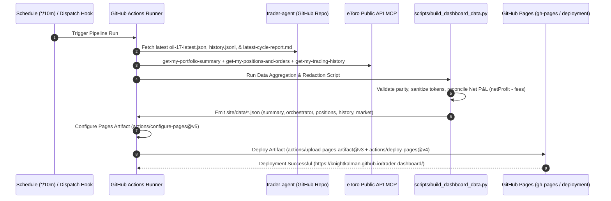
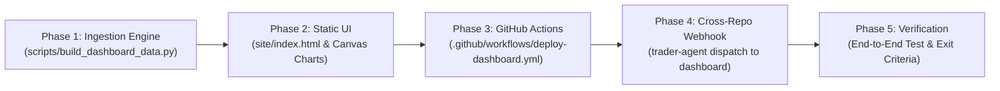

# Step 5: Autonomous Trading Observability, GitHub Pages Dashboard & Automated Reporting

## 1. Executive Summary & Objective

This document defines the complete architecture, data pipeline, visualization layer, and automation workflows for the **Trading Dashboard** (`knightkalman/trader-dashboard`).

The dashboard provides real-time observability, telemetry, and reporting for the **eToro Autonomous Trading Agent** ([`knightkalman/trader-agent`](https://github.com/knightkalman/trader-agent)) and its **10-minute Trading Orchestrator**, specifically monitoring **Oil (Non Expiry) (`OIL` · eToro Instrument ID: `17`)**, its active CFD positions, options/leverage parameters, and order lifecycles.

### Core Objectives:
1. **GitHub Pages Deployment**: Host a fast, responsive, zero-server-maintenance web dashboard on **GitHub Pages** (`https://knightkalman.github.io/trader-dashboard/`) with modern dark financial UI, rich Canvas/SVG charts, and auto-refreshing live feeds.
2. **Self-Updating Pipeline via GitHub Actions**: Establish automated workflows ([`.github/workflows/deploy-dashboard.yml`](../.github/workflows/deploy-dashboard.yml)) running on a recurring 10-minute schedule (plus `repository_dispatch` and `workflow_dispatch` hooks) that ingest the latest market snapshots, orchestrator cycle verdicts, and live eToro portfolio states, build static JSON payloads, and deploy to GitHub Pages.
3. **Full Visibility into Agent & Orchestrator Decisions**: Visualize the orchestrator's 6-block data parity gate, 100-point confluence scoring engine (Regime & News, HTF Alignment, Momentum, Volatility, Spread Efficiency), and 3-phase decision rules (cancel pending, modify/close open, open new entry).
4. **Direct Links to Human-in-the-Loop (HITL) Controls**: Embed direct, one-click control links for every open position and pending order, navigating seamlessly to the interactive controls in `knightkalman/trader-agent` (Issue #1 Control Panel, pre-filled `/issues/new` action forms, and copy-pasteable `gh workflow run` CLI commands) as defined in [`step-2-order-communication-and-protocols.md`](file:///home/kalman/Desktop/git/trading-agent/plan/trading-agent-core/step-2-order-communication-and-protocols.md).
5. **Reconciled P&L, Fee Attribution & Audit Reporting**: Compute fully-loaded realized net profit ($$\text{RealizedNetPnL} = \text{netProfit} - \text{fees}$$), overnight/weekend CFD financing costs, spread friction, and generate automated Daily, Weekly, and Monthly reports.

---

## 2. End-to-End System Architecture

```mermaid
flowchart TD
    subgraph AgentRepo["Trading Agent Repo (knightkalman/trader-agent)"]
        S3["Step 3: Oil Data Enrichment\n(every 9m: data/market_snapshots/oil-17-latest.json)"]
        Orch["Trading Orchestrator\n(every 10m: reports/orchestrator/latest-cycle-report.md)"]
        Exec["Two-Stage Execution Pipeline\n(reports/orders/*, data/trade_lifecycle_log.jsonl)"]
        Issue1["🎛️ Issue #1 Live Control Panel\n(Human-in-the-Loop Checkboxes & Slash Commands)"]
    end

    subgraph eToroCloud["eToro Public API / MCP Server"]
        eToroAPI["eToro MCP (https://mcp.public-api.etoro.com)\n• get-my-portfolio-summary\n• get-my-positions-and-orders\n• get-my-trading-history\n• get-instruments-overview"]
    end

    subgraph DashboardPipeline["Dashboard Repo CI/CD (knightkalman/trader-dashboard)"]
        GHA["GitHub Actions: deploy-dashboard.yml\n(Cron: */10m · repository_dispatch · push)"]
        SyncScript["Data Aggregator & Ingestion Script\n(scripts/build_dashboard_data.py)"]
        StaticPayloads[("Static Datasets (site/data/)\n• summary.json\n• orchestrator.json\n• positions.json\n• history.json\n• market.json")]
        PagesDeploy["GitHub Pages Deploy Action\n(actions/deploy-pages@v4)"]
    end

    subgraph PublicPages["Live Web Dashboard (GitHub Pages)"]
        WebUI["https://knightkalman.github.io/trader-dashboard/\n• KPI Strip & Status Banners\n• Active Trades & HITL Action Links\n• 100-Point Confluence & Parity Visualizer\n• Live Market & Benchmark Comparison\n• Reconciled Equity Curve & Fee Drag\n• MCP Latency & Guardrail Health"]
    end

    subgraph Operator["Human Operator"]
        Human["Operator Browser / Mobile"]
    end

    S3 -->|Committed Snapshots| SyncScript
    Orch -->|Committed Cycle Reports| SyncScript
    Exec -->|Order Confirmations & Receipts| SyncScript
    eToroAPI -->|Live Account State & History| SyncScript

    GHA --> SyncScript
    SyncScript --> StaticPayloads
    StaticPayloads --> PagesDeploy
    PagesDeploy --> WebUI

    WebUI -->|Client Auto-Refresh (every 60s)| StaticPayloads
    Human -->|Views Telemetry & Analytics| WebUI
    WebUI -.->|1. Click Action Link / Pre-filled Form| Issue1
    WebUI -.->|2. Trigger Workflow Dispatch| Exec
    Issue1 -->|Confirmed Approval| Exec
```

---

## 3. Data Integration & Telemetry Sources

The dashboard aggregates data across two primary planes:
1. **Agent State & Artifacts** from `knightkalman/trader-agent`.
2. **Account & Execution Telemetry** from the eToro Public API MCP server.

### 3.1 Sourced Telemetry Files from `trading-agent`

| Telemetry Artifact | Location in `trader-agent` | Cadence | Content & Purpose |
|--------------------|----------------------------|---------|-------------------|
| **Latest Market Snapshot** | `data/market_snapshots/oil-17-latest.json` | Every 9 min | The atomic single-source-of-truth: Oil ID 17 quote, spreads, WTI/Brent benchmarks, 6-block data payload, technical indicators (EMA, RSI, ADX, ATR, RVOL), upstream signal conviction. |
| **Market History Series** | `data/market_snapshots/oil-17-history.jsonl` | Append-only (cap 500) | Historical snapshot series used for price curves, indicator trends, and volatility charts. |
| **Orchestrator Cycle Report** | `reports/orchestrator/latest-cycle-report.md` | Every 10 min | Verdict of the 10-minute cycle: evaluation status (`PASS`, `REJECTED`, `NO_ACTION`), parity gate checks, 100-point confluence breakdown, phase 1/2/3 decision outcomes, cooldown state. |
| **Order Confirmations** | `reports/orders/<signalId>-confirmation.md` | On demand / signal | Stage 1 preparation output: `signalId`, `orderParamsHash`, token expiration timestamp, side-by-side risk parameter previews. |
| **Execution Receipts** | `reports/orders/<signalId>-receipt.md` | On placement | Stage 2 execution outcome: `orderId`, `positionId`, `avgPrice`, `units`, execution timestamps, and MCP logs. |
| **Daily Monitor Snapshots** | `reports/daily/monitor-latest-<account>.md` | Every 30 min | Formatted markdown dump of all active positions and pending orders with current P&L. |

### 3.2 Live eToro MCP API Endpoints Sourced by Dashboard CI

| eToro MCP Tool | Target Query | Data Extracted |
|----------------|--------------|----------------|
| `get-my-portfolio-summary` | `account: demo` (or `real`) | `totals.totalValue`, `totals.availableCash`, `totals.usedMargin`, `totals.unrealizedPnL`, cash reserve %. |
| `get-my-positions-and-orders` | `account: demo`, `includeOrderDetail: true` | Active `direct.positions`, `mirrors`, and pending `direct.orders` with current rates, units, leverage, SL/TP. |
| `get-my-trading-history` | `account: demo`, paginated | Realized trades: `positionId`, `openDateTime`, `closeDateTime`, `openRate`, `closeRate`, `netProfit`, `fees`. |
| `get-instruments-overview` | `instrumentIds: [17]` | Live BID/ASK quotes, spread % and spread markup, market open/close status. |

> [!CAUTION]
> **Credential & Secret Isolation**: GitHub Pages is public. The automated build pipeline in `trading-dashboard` strips and redacts all authentication headers, API keys (`ETORO_API_KEY`, `ETORO_USER_KEY`, `OIL_SIGNAL_API_KEY`), account numbers, and unexpired Stage 1 placement tokens (`ephemeral_tokens/*.json`) before writing public static JSON files to `site/data/`.

---

## 4. Live Dashboard UI Specification (`site/index.html`)

The dashboard is structured into six interactive visual panels designed with a responsive, high-density dark financial theme:

```
+----------------------------------------------------------------------------------------------------+
| 🟢 TRADER DASHBOARD | eToro Autonomous Oil Agent (OIL · ID 17) | Mode: DEMO | Refresh: 10:14:02 UTC |
+----------------------------------------------------------------------------------------------------+
| [KPI Strip] Equity: $10,482.50 | Cash: $9,282.50 | Margin: $1,200 | Unrlz: +$142.20 | Realized: +$84.50 |
+----------------------------------------------------------------------------------------------------+
| PANEL 1: ACTIVE TRADES & HUMAN-IN-THE-LOOP CONTROLS                                               |
| - Running Positions Table (Direct CFD & Mirrors) with Live Rates, Distance to SL/TP & P&L         |
| - HITL Action Buttons: [✏️ Alter SL/TP] [🛡️ Trailing SL] [🌗 Close 50%] [🛑 Close 100%] [📋 Copy CLI]  |
| - Pending Orders Table with [❌ Cancel Order] button                                              |
| - Pending Stage 1 Confirmations with [✅ Approve in Issue #1] Link & Hash Badge                     |
+-----------------------------------------------------------------+----------------------------------+
| PANEL 2: ORCHESTRATOR DECISION FUNNEL                           | PANEL 3: LIVE OIL MARKET & TECHS |
| - Latest Cycle Status: PASS / ACTION_PREPARED                   | - Oil (ID 17): $71.42 (Bid/Ask)  |
| - 6-Block Parity Gate Checklist (All 6 Green)                   | - WTI: $71.35 | Brent: $75.80    |
| - 100-Point Confluence Bar/Radar (Current: 78/100, Min: 65)     | - Divergence: +0.10% (Normal)    |
|   • Regime & News: 28/35  • HTF Alignment: 16/20                | - EMA20/50/200, RSI(14), ADX(14) |
|   • Momentum: 12/15       • Volatility/RVOL: 11/15              | - ATR%: 2.14% | RVOL: 1.42       |
|   • Spread Efficiency: 11/15                                    | - Sentiment: +0.65 (Bullish)     |
| - Phase Evaluation Summary: Phase 1 (0) -> Phase 2 (0) -> Ph 3 | - Support/Resistance Levels      |
+-----------------------------------------------------------------+----------------------------------+
| PANEL 4: EQUITY CURVE & PERFORMANCE METRICS                     | PANEL 5: COST & FEE ATTRIBUTION  |
| - Interactive Realized Equity Progression (Net of Fees)         | - Overnight Financing Fees       |
| - Win Rate (%), Profit Factor, Expectancy per trade ($E)        | - Weekend CFD Holding Costs      |
| - Closed Trade Journal Table with Gross vs Net P&L              | - Spread Drag % vs Gross Return  |
+-----------------------------------------------------------------+----------------------------------+
| PANEL 6: SYSTEM, MCP HEALTH & RATE LIMIT TELEMETRY                                                |
| - MCP Latency: 142ms | Rate Limits: 94% Remaining | Circuit Breaker: Normal (Drawdown: -0.4%)      |
+----------------------------------------------------------------------------------------------------+
```

---

### Panel 1: Active Positions, Pending Orders & Human-in-the-Loop (HITL) Controls

This panel gives the operator instantaneous situational awareness and direct command over running positions, implementing the protocols defined in [`step-2-order-communication-and-protocols.md`](file:///home/kalman/Desktop/git/trading-agent/plan/trading-agent-core/step-2-order-communication-and-protocols.md).

#### 1. Open Positions Table (`direct.positions` & `mirrors`)
* Columns:
  * `Position ID`: Unique eToro position identifier (e.g., `3625441963`).
  * `Symbol / Market`: `OIL (Non Expiry)` (Instrument ID 17).
  * `Direction & Leverage`: `BUY` / `SELL SHORT` badge with leverage multiplier (e.g., `5x`).
  * `Invested Amount`: Position cash allocation (e.g., `$200.00`).
  * `Units`: Exposure volume (e.g., `14.0042`).
  * `Open Rate vs Current Rate`: Entry price vs live quote with percentage drift.
  * `Stop Loss & Take Profit`: Configured SL and TP rates, with distance-to-trigger percentage and SL type badge (`fixed` vs `trailing`).
  * `Unrealized P&L`: Real-time floating profit/loss formatted in green/red with both dollar amount and percentage return.
  * **Interactive HITL Action Links**:
    * **`[✏️ Alter SL/TP]`**: Opens a pre-filled GitHub Issue URL in `knightkalman/trader-agent` targeting `/issues/new?labels=trade-control&title=...` with pre-populated JSON payload to modify `stopLossRate` and `takeProfitRate`.
    * **`[🛡️ Trailing SL]`**: Pre-filled action URL to toggle `stopLossType: trailing`.
    * **`[🌗 Scale Out 50%]`**: Pre-filled action URL to execute partial close (`unitsToDeduct: units / 2`).
    * **`[🛑 Close 100%]`**: Pre-filled action URL to trigger full position termination.
    * **`[📋 Copy CLI]`**: One-click button that copies the corresponding `gh workflow run` command to the clipboard:
      ```bash
      gh workflow run trading-agent-pipeline.yml -R knightkalman/trader-agent \
        -f account=demo -f action=close -f position_id=3625441963
      ```

#### 2. Active Pending Orders Table (`direct.orders`)
* Columns: `Order ID`, `Symbol`, `Direction`, `Order Type` (`mkt` / `mit`), `Amount`, `Trigger Rate`, `Limit Rate`, `Current Distance %`, `Status`.
* **HITL Action Link**:
  * **`[❌ Cancel Order]`**: Direct link opening a pre-filled cancellation issue or copyable CLI command:
    ```bash
    gh workflow run trading-agent-pipeline.yml -R knightkalman/trader-agent \
      -f account=demo -f action=cancel -f order_id=388768900
    ```

#### 3. Pending Stage 1 Confirmations Banner
* Displayed prominently when the orchestrator has prepared an order and is awaiting human confirmation.
* Shows: `Signal ID`, `Action` (`open` / `close`), `Symbol`, `Order Params Hash` (first 12 chars), and Token TTL countdown timer.
* Direct action buttons:
  * **`[✅ Confirm Order in Issue #1]`**: Deep-links directly to `https://github.com/knightkalman/trader-agent/issues/1` where the operator can tick the checkbox or reply `/confirm <signalId> <hash>`.
  * **`[🚀 Approve via Workflow Dispatch]`**: Links to GitHub Actions workflow dispatch with pre-filled inputs.

---

### Panel 2: Orchestrator Decision Funnel & Confluence Engine Visualizer

Visualizes the automated reasoning performed every 10 minutes by `src/orchestrator/` in `trading-agent`:

1. **Cycle Summary Header**:
   * Last Run Timestamp & Execution Mode (`prepare_only`, `auto_execute_risk_reducing`, `auto_execute_all`).
   * Decided Action Badge: `NONE`, `OPEN_PREPARED`, `POSITION_CLOSED`, `POSITION_MODIFIED`, `ORDER_CANCELLED`, `VETOED`.
2. **6-Block Data Parity Gate**:
   * Visual status indicators verifying that the 6 required data blocks are present and uncorrupted:
     1. Upstream Signal Block
     2. Benchmarks (WTI & Brent)
     3. Direction Compression (24h/7d/30d Regimes)
     4. AI News Sentiment Score
     5. eToro Market Overview & Quote
     6. Technicals & External Context (EMA, RSI, ADX, ATR, RVOL)
3. **100-Point Confluence Engine Scorecard**:
   * Progress bar / radial gauge displaying the total confluence score against the minimum qualification threshold (**65 / 100**).
   * Detailed breakdown across the 5 scoring pillars:
     * **Direction Regime & News Conviction** (Max 35 pts)
     * **Multi-Timeframe & Compression Alignment** (Max 20 pts)
     * **Momentum Oscillators (RSI14 & ADX14)** (Max 15 pts)
     * **Volatility & Relative Volume (ATR% & RVOL)** (Max 15 pts)
     * **Spread Efficiency & Cost Friction** (Max 15 pts)
4. **Three-Phase Rule Evaluation Matrix**:
   * **Phase 1 (Pending Orders)**: Displays evaluated cancellation rules (order age > 60 min, regime flip, price divergence > 2×ATR).
   * **Phase 2 (Open Positions)**: Evaluates position management hierarchy (1. Regime reversal, 2. High event risk, 3. Time stop > 48h, 4. +1.5R scale out, 5. +1.2R trailing SL, 6. +1.0R breakeven).
   * **Phase 3 (New Entries)**: Evaluates entry rules and checks hard vetoes (weekend closure, unapproved instrument, WTI divergence > 2.5%, spread > 20% target, account drawdown ≤ -2.5%, insufficient cash).

---

### Panel 3: Live Oil Market, Benchmarks & Technicals

Provides institutional-grade market context for **Oil (ID 17)**:

1. **Live Quote & Physical Benchmarks**:
   * eToro Oil CFD Quote: Bid, Ask, Spread ($ and %).
   * Upstream Benchmarks: WTI Spot ($), Brent Spot ($).
   * Divergence Indicator: Percentage divergence between WTI spot and eToro CFD quote (Veto triggered if > 2.5%).
2. **Technical Indicator Dashboard**:
   * Trend: `EMA 20`, `EMA 50`, `SMA 200` with Bullish/Bearish stacking status.
   * Momentum: `RSI(14)` (overbought/oversold bands at 70/30) and `ADX(14)` (trend strength gauge, threshold 25).
   * Volatility & Liquidity: `ATR(14)`, `ATR%` (target range 1.5%–4.0%), and `RVOL` (Relative Volume vs 20-period average).
   * Price Levels: Key Support & Resistance levels identified by the enricher.
3. **Market Sentiment & Event Risk**:
   * AI News Sentiment Score (`-1.0` to `+1.0`) with sentiment label (Strongly Bearish, Bearish, Neutral, Bullish, Strongly Bullish).
   * Direction Compression summary across `24h`, `7d`, and `30d` lookback windows.
   * Weekend Market Status indicator & Event Risk Flag (`NORMAL`, `ELEVATED`, `HIGH`).

---

### Panel 4: Reconciled Performance, Equity Curve & Trade Journal

Accurately tracks financial performance, avoiding eToro's unadjusted reporting pitfalls:

1. **Reconciled Performance Metrics**:
   * **Realized Net P&L**:
     $$\text{RealizedNetPnL} = \sum_{i=1}^{N} (\text{netProfit}_i - \text{fees}_i)$$
     *(Mandatory: Deducts overnight CFD fees and commissions from raw `netProfit`)*.
   * **Win Rate**: Percentage of closed trades where $$\text{netProfit} - \text{fees} > 0$$.
   * **Profit Factor**: Gross gains divided by absolute gross losses (net of fees).
   * **Expectancy ($E$)**: Average dollar expected per trade execution.
   * **Max Historical Drawdown**: Peak-to-trough equity decline percentage.
2. **Interactive Equity Curve**:
   * Time-series chart tracking portfolio value over time (realized equity + floating unrealized P&L).
   * Milestone markers showing when positions were opened, modified, or closed.
3. **Historical Trade Log**:
   * Paginated, searchable table of closed positions sourced from `get-my-trading-history`.
   * Columns: `Position ID`, `Symbol`, `Direction`, `Open Time`, `Close Time`, `Hold Duration`, `Open Rate`, `Close Rate`, `Gross Profit`, `Fees Paid`, `Net P&L ($ / %)`, `Exit Trigger` (Take-Profit, Stop-Loss, Trailing-Stop, Time-Stop, Manual Close).

---

### Panel 5: Cost & CFD Fee Attribution

Transparently isolates the true drag of trading leveraged CFDs on eToro:

1. **Financing Fee Breakdown**:
   * Cumulative Overnight Holding Fees ($).
   * Weekend Financing Charges ($).
   * Currency Conversion & Transaction Fees ($).
2. **Spread Friction Ratio**:
   * $$\text{FeeDragPct} = \frac{\sum \text{fees} + \sum \text{estimatedSpread}}{\sum |\text{netProfit}|} \times 100$$
   * Warns operator if fee drag exceeds 15% of gross profits.

---

### Panel 6: System, MCP API Health & Safety Guardrails

Monitors the operational stability of the GitHub Actions runners and eToro Public API MCP server:

1. **Rate Limiting & Endpoint Telemetry**:
   * Rate limit consumption per endpoint group (`rateLimitRemaining` vs limit).
   * MCP Tool Latency tracking (ms per call).
   * Backoff event log (HTTP 429 occurrences).
2. **Safety Circuit Breakers**:
   * Daily Drawdown Circuit Breaker gauge (Current drawdown vs `-3.0%` halt threshold).
   * Global Kill-Switch Status (`TRADING_HALTED` repo variable / `data/HALT` presence).
   * Single-Instrument Concentration check (Oil exposure vs allowable portfolio allocation).
   * Ephemeral Token Security: Confirms zero unexpired tokens or credentials are leaked in public payloads.

---

## 5. Self-Updating GitHub Actions Pipeline Specification

The dashboard is generated and deployed completely via GitHub Actions in `knightkalman/trader-dashboard`.

### 5.1 Pipeline Architecture (`.github/workflows/deploy-dashboard.yml`)



### 5.2 Workflow Configuration File

```yaml
name: Deploy Trading Observability Dashboard to GitHub Pages

on:
  schedule:
    - cron: "*/10 * * * *"
  workflow_dispatch:
    inputs:
      account:
        description: "Target eToro Account (demo or real)"
        required: false
        default: "demo"
        type: choice
        options:
          - demo
          - real
      force_rebuild:
        description: "Force complete historical data re-ingestion"
        required: false
        default: false
        type: boolean
  repository_dispatch:
    types:
      - etoro-order-signal
      - orchestrator-cycle-completed
      - refresh-dashboard
  push:
    branches:
      - main
    paths:
      - "site/**"
      - "scripts/**"
      - ".github/workflows/deploy-dashboard.yml"

permissions:
  contents: write
  pages: write
  id-token: write

concurrency:
  group: github-pages-deploy
  cancel-in-progress: false

env:
  ETORO_MCP_URL: ${{ vars.ETORO_MCP_URL || 'https://mcp.public-api.etoro.com' }}
  ETORO_DEFAULT_ACCOUNT: ${{ inputs.account || vars.ETORO_DEFAULT_ACCOUNT || 'demo' }}
  TRADING_AGENT_REPO: "knightkalman/trader-agent"
  PYTHONUNBUFFERED: "1"

jobs:
  build-and-deploy:
    environment:
      name: github-pages
      url: ${{ steps.deployment.outputs.page_url }}
    runs-on: ubuntu-latest
    steps:
      - name: Checkout trader-dashboard repository
        uses: actions/checkout@v4

      - name: Set up Python
        uses: actions/setup-python@v5
        with:
          python-version: "3.12"

      - name: Install Dependencies
        run: |
          python -m pip install --upgrade pip
          pip install requests pydantic urllib3

      - name: Ingest Agent Telemetry & eToro Account Data
        env:
          GH_TOKEN: ${{ secrets.DASHBOARD_GITHUB_TOKEN || github.token }}
          ETORO_API_KEY: ${{ secrets.ETORO_API_KEY }}
          ETORO_USER_KEY: ${{ secrets.ETORO_USER_KEY }}
          ACCOUNT_MODE: ${{ env.ETORO_DEFAULT_ACCOUNT }}
        run: |
          python3 scripts/build_dashboard_data.py \
            --agent-repo "${TRADING_AGENT_REPO}" \
            --account "${ACCOUNT_MODE}" \
            --output-dir site/data

      - name: Validate Generated Dashboard Payloads
        run: |
          python3 -c "
          import json, sys
          from pathlib import Path
          required = ['summary.json', 'orchestrator.json', 'positions.json', 'history.json', 'market.json']
          missing = [f for f in required if not (Path('site/data') / f).is_file()]
          if missing:
              print(f'ERROR: Missing required data files: {missing}', file=sys.stderr)
              sys.exit(1)
          print('All dashboard JSON payloads successfully verified.')
          "

      - name: Commit Updated Historical Datasets to main ([skip ci])
        run: |
          git config user.name "github-actions[bot]"
          git config user.email "41898282+github-actions[bot]@users.noreply.github.com"
          git add data/
          if ! git diff --cached --quiet; then
            git commit -m "Update persistent dashboard telemetry [skip ci]"
            git pull --rebase origin main || true
            git push origin HEAD:main
          fi

      - name: Setup GitHub Pages
        uses: actions/configure-pages@v5

      - name: Upload Pages Artifact
        uses: actions/upload-pages-artifact@v3
        with:
          path: site

      - name: Deploy to GitHub Pages
        id: deployment
        uses: actions/deploy-pages@v4
```

---

## 6. Human-in-the-Loop (HITL) Integration Mechanics

Every position, order, and prepared trade surfaced on the dashboard is equipped with interactive links that connect back to the control interfaces implemented in `knightkalman/trader-agent`:

```mermaid
flowchart TD
    Dashboard["Live Dashboard on GitHub Pages\n(https://knightkalman.github.io/trader-dashboard/)"]

    subgraph ActionOptions["Interactive Action Options"]
        IssueLink["1. Deep-Link to Issue #1\n(Pinned Live Control Panel)"]
        NewIssueBtn["2. Pre-filled /issues/new Form\n(One-Click Parameter Submission)"]
        CliCopyBtn["3. Copy gh workflow run Command\n(Terminal Execution)"]
    end

    subgraph AgentPipeline["trader-agent Execution Pipeline"]
        GHEvent["trading-agent-pipeline.yml\n(handle-github-event / workflow_dispatch)"]
        TwoStage["Two-Stage Execution Gate\n(Stage 1 Prepare -> Stage 2 Place)"]
    end

    Dashboard --> IssueLink
    Dashboard --> NewIssueBtn
    Dashboard --> CliCopyBtn

    IssueLink -->|Check `- [x]` or Slash Command| GHEvent
    NewIssueBtn -->|Create Issue with Label `trade-control`| GHEvent
    CliCopyBtn -->|Run in Operator Terminal| GHEvent

    GHEvent --> TwoStage
```

### 6.1 Action Link Construction Rules

The data ingestion script constructs deterministic action URLs using the pattern defined in `trader-agent`'s `src/agent_core/interactive_control.py`:

1. **Alter SL/TP (`action=modify`)**:
   ```
   https://github.com/knightkalman/trader-agent/issues/new?labels=trade-control&title=[TRADE-CONTROL]+MODIFY+Position+{positionId}&body=...
   ```
   *Pre-fills JSON body with `account`, `action: "modify"`, `positionId`, `stopLossRate`, `takeProfitRate`, and `executeImmediately: false`.*
2. **Trailing Stop-Loss Toggle (`action=modify`)**:
   ```
   https://github.com/knightkalman/trader-agent/issues/new?labels=trade-control&title=[TRADE-CONTROL]+TRAILING-SL+Position+{positionId}&body=...
   ```
   *Pre-fills `stopLossType: "trailing"`.*
3. **Partial Scale-Out 50% (`action=close`)**:
   ```
   https://github.com/knightkalman/trader-agent/issues/new?labels=trade-control&title=[TRADE-CONTROL]+CLOSE+50%+Position+{positionId}&body=...
   ```
   *Pre-fills `action: "close"`, `positionId`, and `unitsToDeduct: units / 2`.*
4. **Full Position Close 100% (`action=close`)**:
   ```
   https://github.com/knightkalman/trader-agent/issues/new?labels=trade-control&title=[TRADE-CONTROL]+CLOSE+100%+Position+{positionId}&body=...
   ```
   *Pre-fills `action: "close"`, `positionId`, and `unitsToDeduct: null`.*
5. **Cancel Pending Order (`action=cancel`)**:
   ```
   https://github.com/knightkalman/trader-agent/issues/new?labels=trade-control&title=[TRADE-CONTROL]+CANCEL+Order+{orderId}&body=...
   ```
   *Pre-fills `action: "cancel"` and `orderId`.*
6. **Confirm Prepared Order (`action=confirm`)**:
   ```
   https://github.com/knightkalman/trader-agent/issues/1
   ```
   *Links directly to the Pinned Control Panel Issue where the operator ticks the checkbox `- [x] Confirm signal <signalId>` or comments `/confirm <signalId> <orderParamsHash>`.*

---

## 7. Data Aggregation & Ingestion Script Specification (`scripts/build_dashboard_data.py`)

A standalone Python script executed by GitHub Actions to pull upstream agent data, query the eToro MCP, redact credentials, and generate static JSON payloads:

### 7.1 Script Architecture
1. **Upstream Ingestion (`fetch_agent_artifacts`)**:
   * Downloads `oil-17-latest.json`, `oil-17-history.jsonl`, and `reports/orchestrator/latest-cycle-report.md` from `knightkalman/trader-agent` using the GitHub API or raw content URLs.
2. **Live Account Query (`fetch_etoro_state`)**:
   * Uses `ETORO_USER_KEY` and `ETORO_API_KEY` to query `get-my-portfolio-summary`, `get-my-positions-and-orders`, and `get-my-trading-history`.
3. **Data Parity & Confluence Parser (`parse_orchestrator_report`)**:
   * Parses the markdown report into structured JSON: cycle status, parity checks, confluence scores (35/20/15/15/15), and phase decisions.
4. **Action Link Generator (`build_action_links`)**:
   * Generates the pre-filled issue URLs and CLI commands for every open position and pending order.
5. **Sanitization & Redaction (`sanitize_payloads`)**:
   * Strips all authorization tokens, API keys, and private account identifiers.
6. **Payload Serialization**:
   * Writes the following files to `site/data/`:
     * `summary.json`: High-level KPIs, system status, circuit breaker states, last refresh timestamp.
     * `positions.json`: Active positions, pending orders, and prepared confirmations with action links.
     * `orchestrator.json`: Latest cycle verdict, 6-block parity checklist, 100-point confluence breakdown.
     * `market.json`: Oil ID 17 quotes, WTI/Brent benchmarks, divergence %, technical indicators.
     * `history.json`: Reconciled realized trade history, performance ratios, fee attribution.

---

## 8. Automated Periodic Reporting (`reports/`)

In addition to the live web dashboard, the system generates version-controlled Markdown reports in `trading-dashboard`:

1. **Daily Report (`reports/daily/YYYY-MM-DD.md`)**:
   * Generated daily at `00:05 UTC`.
   * Realized Net P&L today ($$\text{netProfit} - \text{fees}$$), count of signals evaluated, trades opened/closed today, overnight CFD financing fees incurred.
2. **Weekly Performance Review (`reports/weekly/YYYY-Www.md`)**:
   * Generated Sunday at `23:00 UTC`.
   * Week-over-week equity curve, win rate, profit factor, expectancy, confluence score calibration (comparing performance of signals scored 65–75 vs 75–85 vs 85+), and fee drag ratio.
3. **Monthly Governance & Audit (`reports/monthly/YYYY-MM.md`)**:
   * Generated on the 1st of each month.
   * Month-end equity progression, cumulative return since inception, Sharpe/Sortino ratios, risk circuit-breaker audit, and parameter tuning recommendations.

---

## 9. Phased Implementation Roadmap & Deliverables



### Phase 1: Ingestion Engine & Data Contract
- [ ] Create `scripts/build_dashboard_data.py` to fetch telemetry from `knightkalman/trader-agent` and eToro MCP.
- [ ] Implement robust markdown parsing for `reports/orchestrator/latest-cycle-report.md`.
- [ ] Implement data redaction to guarantee zero secret leakage into `site/data/`.
- [ ] Implement accurate net P&L reconciliation ($$\text{netProfit} - \text{fees}$$).

### Phase 2: Static Dashboard Web Application (`site/`)
- [ ] Build responsive, dark-mode single-page application in `site/index.html`.
- [ ] Render KPI strip, active positions table, and pending orders table.
- [ ] Embed the HITL interactive action buttons (`[✏️ Alter SL/TP]`, `[🛡️ Trailing SL]`, `[🌗 Close 50%]`, `[🛑 Close 100%]`, `[❌ Cancel Order]`).
- [ ] Build interactive Canvas/SVG charts for:
  - 100-Point Confluence Engine gauge & component bars.
  - Oil quote vs WTI/Brent benchmark divergence.
  - Reconciled Equity progression curve.
- [ ] Add client-side 60-second polling for `site/data/*.json` with live timestamp refresh indicator.

### Phase 3: GitHub Actions Deployment Pipeline
- [ ] Create `.github/workflows/deploy-dashboard.yml`.
- [ ] Configure GitHub Pages environment (`github-pages`) and deployment permissions (`pages: write`, `id-token: write`).
- [ ] Test scheduled cron (`*/10 * * * *`) and `workflow_dispatch` execution.
- [ ] Verify deployment at `https://knightkalman.github.io/trader-dashboard/`.

### Phase 4: Cross-Repository Automation Hooks
- [ ] Configure `repository_dispatch` trigger in `deploy-dashboard.yml`.
- [ ] Add post-run notification step in `trading-agent` (`trading-orchestrator.yml` and `trading-agent-pipeline.yml`) to dispatch an event to `knightkalman/trader-dashboard` upon cycle completion or order placement.

### Phase 5: Verification & Operational Readiness
- [ ] Verify all HITL links resolve correctly to Issue #1 or pre-filled issue forms in `knightkalman/trader-agent`.
- [ ] Verify correct representation of CFD leverage, financing fees, and spread drag.
- [ ] Verify mobile responsiveness and fast page load times (< 1 second).

---

## 10. Exit Criteria Checklist

- [ ] **GitHub Pages Live**: `https://knightkalman.github.io/trader-dashboard/` renders live data with zero console errors.
- [ ] **Automated Pipeline Active**: GitHub Actions workflow runs every 10 minutes and on demand, rebuilding and deploying without human intervention.
- [ ] **HITL Integration Tested**: Clicking `[✏️ Alter SL/TP]`, `[🛡️ Trailing SL]`, `[🌗 Close 50%]`, or `[🛑 Close 100%]` opens the correct pre-filled action form in `knightkalman/trader-agent`.
- [ ] **Orchestrator Confluence Visualized**: Confluence score (out of 100) and 6-block data parity gates are dynamically rendered.
- [ ] **Zero Secret Leakage**: Verified that no API keys, private tokens, or unexpired tokens exist in `site/data/` or Git history.
- [ ] **Net P&L Reconciled**: Closed trades and equity curves accurately reflect `netProfit - fees`.
